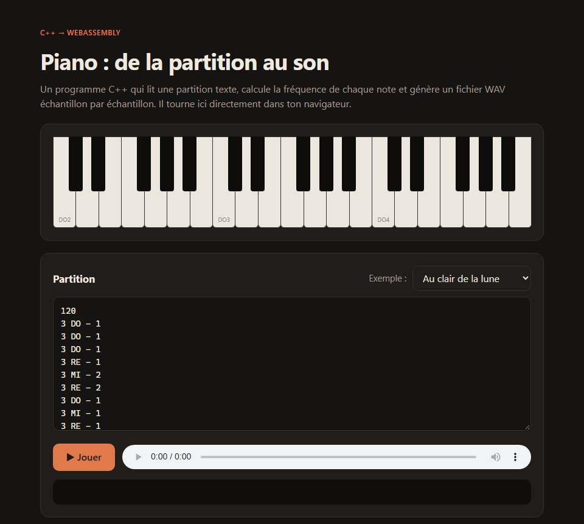
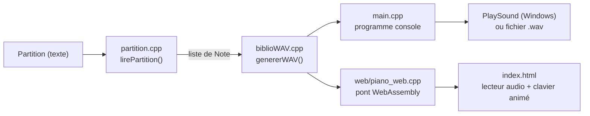
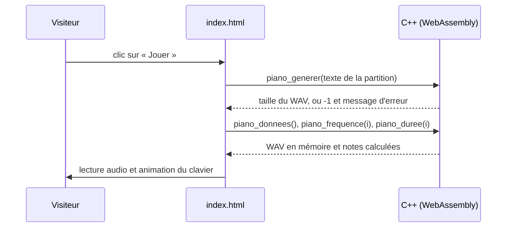

<div align="center">

# 🎹 Piano

**De la partition texte au fichier audio : un synthétiseur en C++17, jouable dans le navigateur grâce à WebAssembly.**

[](https://github.com/Nick-Suebang/piano/actions/workflows/pages.yml)
[](https://nick-suebang.github.io/piano/)


[](LICENSE)

[**▶ Essayer la démo**](https://nick-suebang.github.io/piano/) · [Format de partition](#format-de-partition) · [Architecture](#architecture) · [Compilation](#compilation)

<a href="https://nick-suebang.github.io/piano/"></a>

</div>

---

## Sommaire

- [À propos](#à-propos)
- [Fonctionnalités](#fonctionnalités)
- [Démarrage rapide](#démarrage-rapide)
- [Format de partition](#format-de-partition)
- [Architecture](#architecture)
- [Version web (WebAssembly)](#version-web-webassembly)
- [Compilation](#compilation)
- [Tests et intégration continue](#tests-et-intégration-continue)
- [Format WAV généré](#format-wav-généré)
- [Structure du dépôt](#structure-du-dépôt)
- [Limites et pistes d'amélioration](#limites-et-pistes-damélioration)
- [Crédits et licence](#crédits-et-licence)

## À propos

**Piano** lit une partition décrite dans un simple fichier texte, calcule la fréquence et la durée de chaque note,
puis synthétise le son **échantillon par échantillon** dans un fichier WAV (PCM 16 bits, stéréo, 44,1 kHz),
sans aucune bibliothèque audio externe.

Le projet est né d'un travail pratique de programmation en C++ (application console Windows). Il a ensuite été
restructuré pour séparer clairement la logique du reste, rendu multiplateforme, couvert par des tests,
et compilé en **WebAssembly** pour que n'importe qui puisse l'essayer en un clic, sans rien installer.

## Fonctionnalités

- 🎼 **Lecture de partitions texte** : tempo, octave, note, altération (dièse/bémol) et durée en temps.
- 🔊 **Synthèse sonore** : onde sinusoïdale par note, avec fondu d'entrée et de sortie pour éviter les clics.
- 💾 **Écriture WAV maison** : en-têtes RIFF/WAVE écrits octet par octet, en petit-boutiste (little-endian).
- ✅ **Validation stricte** : une erreur dans la partition est signalée avec son numéro de ligne, au lieu de produire une fausse note.
- 🖥️ **Multiplateforme** : lecture directe sous Windows (`PlaySound`), écriture d'un fichier `.wav` partout.
- 🌐 **Démo web** : le même code C++ compilé en WebAssembly, avec un clavier animé synchronisé sur la lecture.
- 🧪 **Tests automatisés** et **CI GitHub Actions** : compilation avec avertissements traités en erreurs, tests de bout en bout, déploiement continu sur GitHub Pages.

## Démarrage rapide

### En ligne

Ouvrir **[nick-suebang.github.io/piano](https://nick-suebang.github.io/piano/)**, choisir un exemple ou écrire une partition, puis cliquer sur **▶ Jouer**.

### En ligne de commande

```bash
git clone https://github.com/Nick-Suebang/piano.git
```

```bash
cd piano && g++ -std=c++17 -O2 main.cpp partition.cpp biblioWAV.cpp -o piano
```

```bash
./piano partitions/au_clair_de_la_lune.txt sortie.wav
```

Sous Windows, avec l'exécutable compilé par Visual Studio, omettre le fichier de sortie joue directement la partition :

```bash
Piano.exe partitions\au_clair_de_la_lune.txt
```

| Commande | Effet |
| --- | --- |
| `piano <partition.txt>` | Joue la partition (Windows) ou l'écrit dans `partition.wav` (autres systèmes) |
| `piano <partition.txt> <sortie.wav>` | Écrit la partition dans le fichier WAV indiqué |

| Code de sortie | Signification |
| --- | --- |
| `0` | Succès |
| `1` | Mauvais nombre d'arguments |
| `2` | Fichier introuvable ou partition invalide |
| `3` | Impossible d'écrire le fichier WAV |

## Format de partition

```text
120
3 DO - 1
3 RE # 0.5
3 MI - 2
2 SI b 1
```

**Première ligne : le tempo**, `60` ou `120` battements par minute.

**Puis une note par ligne** : `<octave> <NOTE> <altération> <durée>`

| Champ | Valeurs | Exemple |
| --- | --- | --- |
| Octave | Entier ; l'octave `3` contient le LA à 440 Hz | `3` |
| Note | `DO` `RE` `MI` `FA` `SO` `LA` `SI` (majuscules) | `SO` |
| Altération | `#` dièse, `b` bémol, `-` aucune | `#` |
| Durée | En temps : `1` noire, `2` blanche, `4` ronde, `0.5` croche | `0.5` |

Les lignes vides sont ignorées. Toute autre erreur arrête la lecture avec un message précis, par exemple :

```text
Erreur : ligne 2 : note « do - » inconnue (notes : DO RE MI FA SO LA SI ; altérations : # b -).
```

### Calcul des fréquences

Les notes suivent le **tempérament égal**, avec le LA de l'octave 3 comme référence :

```text
fréquence = 440 × 2^((octave − 3) + (demi-tons − 9) / 12)
```

où `demi-tons` est la position de la note dans l'octave à partir de DO (DO = 0, RE = 2, MI = 4, FA = 5, SO = 7, LA = 9, SI = 11),
ajustée de ±1 par l'altération.

| Note | `2 LA -` | `3 DO -` | `3 LA -` | `4 DO -` |
| --- | --- | --- | --- | --- |
| Fréquence | 220,00 Hz | 261,63 Hz | 440,00 Hz | 523,25 Hz |

La durée d'une note vaut `durée × 60 000 / tempo` millisecondes : une noire dure 500 ms à 120 bpm.

## Architecture



| Module | Responsabilité |
| --- | --- |
| [`note.h`](note.h) | `struct Note { frequenceHz, dureeMs }` : la donnée échangée entre les modules |
| [`partition.h`](partition.h) / [`partition.cpp`](partition.cpp) | Analyse et validation du texte, calcul des fréquences et des durées |
| [`biblioWAV.h`](biblioWAV.h) / [`biblioWAV.cpp`](biblioWAV.cpp) | Synthèse des échantillons, écriture du WAV, lecture sur la carte son |
| [`main.cpp`](main.cpp) | Point d'entrée console : arguments, messages, codes de sortie |
| [`web/piano_web.cpp`](web/piano_web.cpp) | Point d'entrée web : expose les fonctions C++ au JavaScript |

### Choix de conception

- **Séparation logique / entrées-sorties.** `lirePartition` n'affiche rien : elle renvoie les notes ou un message d'erreur.
  C'est l'appelant (console ou page web) qui décide comment le présenter, ce qui permet de réutiliser le même code
  sur les deux plateformes sans `#ifdef`.
- **Une structure plutôt que des tableaux parallèles.** Une `Note` regroupe sa fréquence et sa durée dans un `std::vector`,
  sans limite arbitraire du nombre de notes.
- **Des flux plutôt que des fichiers.** La lecture prend un `std::istream` et l'écriture un `std::ostream` :
  la même fonction lit un fichier, une chaîne venant du navigateur ou une entrée de test.
- **Des données plutôt que des conditions.** La gamme est une table `constexpr` ; les grandeurs (fréquence d'échantillonnage,
  amplitude, fondu…) sont des constantes nommées.
- **Pas d'exceptions dans le flux normal.** Les erreurs de saisie sont des cas attendus : elles passent par une valeur de retour
  et `std::optional`, ce qui garde aussi le module WebAssembly léger.

## Version web (WebAssembly)

`partition.cpp` et `biblioWAV.cpp` sont compilés avec [Emscripten](https://emscripten.org), avec
`web/piano_web.cpp` comme point d'entrée à la place de `main.cpp`. Tout s'exécute **dans le navigateur du visiteur** :
aucun serveur ne fait de calcul.



| Fonction exportée | Rôle |
| --- | --- |
| `piano_generer(const char*)` | Lit la partition et génère le WAV ; retourne sa taille en octets, ou `-1` |
| `piano_donnees()` | Adresse du WAV dans la mémoire WebAssembly |
| `piano_nombre_notes()` | Nombre de notes lues |
| `piano_frequence(int)` / `piano_duree(int)` | Fréquence et durée d'une note, pour animer le clavier |

Les messages écrits avec `std::cout` par le C++ sont redirigés vers la console affichée sur la page.

## Compilation

### Prérequis

| Cible | Outils |
| --- | --- |
| Windows | Visual Studio 2022 ou plus récent, charge de travail « Développement Desktop en C++ » |
| Linux / macOS | Compilateur C++17 (GCC 8+ ou Clang 7+) |
| Web | [Emscripten](https://emscripten.org/docs/getting_started/downloads.html) (`em++`) |

### Windows (Visual Studio)

1. Ouvrir `Piano.sln`.
2. Choisir la configuration (`Release` / `x64` recommandé), puis **Générer** (F7).
3. Lancer avec un argument de ligne de commande : *Propriétés du projet → Débogage → Arguments de la commande*.

Le projet compile en C++17 avec les avertissements de niveau 4. La bibliothèque `winmm` (pour `PlaySound`)
est liée automatiquement.

### Linux / macOS

```bash
g++ -std=c++17 -Wall -Wextra -Wpedantic -O2 main.cpp partition.cpp biblioWAV.cpp -o piano
```

### Web

Avec Emscripten installé et activé :

```bash
bash web/build.sh
```

Le site est généré dans `dist/` (`index.html`, `piano.js`, `piano.wasm`). Pour le tester localement, il faut le servir
en HTTP (le navigateur refuse de charger le `.wasm` depuis un fichier local) :

```bash
python -m http.server 8000 --directory dist
```

## Tests et intégration continue

Le script [`tests/tester.sh`](tests/tester.sh) teste le programme de bout en bout :

- chaque partition de [`partitions/`](partitions) produit un WAV dont l'en-tête annonce les bonnes tailles ;
- les partitions invalides (tempo non numérique ou non autorisé, note ou altération inconnue, champ manquant,
  durée nulle, partition vide) sont refusées avec le code `2` ;
- un fichier introuvable et de mauvais arguments donnent les bons codes de sortie.

```bash
bash tests/tester.sh ./piano
```

Le workflow [`.github/workflows/pages.yml`](.github/workflows/pages.yml) s'exécute à chaque pull request et à chaque push sur `main` :

| Tâche | Détail |
| --- | --- |
| **Version console (Linux)** | Compilation avec `-Wall -Wextra -Wpedantic -Werror`, puis exécution des tests |
| **Version web (WebAssembly)** | Compilation avec Emscripten |
| **Publication GitHub Pages** | Sur `main` uniquement, si les deux tâches précédentes réussissent |

## Format WAV généré

| Paramètre | Valeur |
| --- | --- |
| Encodage | PCM linéaire, entiers signés 16 bits |
| Canaux | 2 (stéréo, même signal à gauche et à droite) |
| Fréquence d'échantillonnage | 44 100 Hz |
| Débit | 176 400 octets par seconde |
| Amplitude maximale | 32 760 (juste sous la limite des 16 bits) |
| Fondu | 5 % de chaque note en entrée et en sortie |

```text
Offset  Taille  Contenu
0       4       "RIFF"
4       4       Taille du fichier − 8
8       4       "WAVE"
12      4       "fmt "
16      4       Taille du bloc format (16)
20      2       Format audio (1 = PCM)
22      2       Nombre de canaux (2)
24      4       Fréquence d'échantillonnage (44100)
28      4       Octets par seconde (176400)
32      2       Octets par bloc (4)
34      2       Bits par échantillon (16)
36      4       "data"
40      4       Taille des données audio
44      …       Échantillons : gauche, droite, gauche, droite…
```

## Structure du dépôt

```text
piano/
├── main.cpp                 Programme console
├── note.h                   Structure Note
├── partition.h / .cpp       Lecture et validation des partitions
├── biblioWAV.h / .cpp       Synthèse et écriture WAV
├── partitions/              Exemples de partitions
├── tests/tester.sh          Tests de bout en bout
├── web/
│   ├── piano_web.cpp        Pont C++ ↔ JavaScript
│   ├── index.html           Page de la démo
│   └── build.sh             Compilation WebAssembly
├── docs/apercu.png          Capture de la démo
├── .github/workflows/       Intégration et déploiement continus
├── Piano.sln / .vcxproj     Projet Visual Studio
└── .editorconfig            Conventions d'édition (UTF-8 avec BOM, 4 espaces)
```

## Limites et pistes d'amélioration

Les limites suivantes viennent de l'énoncé d'origine ou de choix volontairement simples :

- **Tempo** limité à 60 ou 120 bpm.
- **Une seule voix** : pas d'accords ni de polyphonie.
- **Pas de silences** : une partition ne peut pas encore contenir de pause.
- **Timbre unique** : une sinusoïde pure, sans harmoniques ni enveloppe ADSR.

Pistes d'évolution : silences (`R` pour *rest*), tempo libre, plusieurs pistes mixées, formes d'onde
(carré, dent de scie) et enveloppe ADSR, import de fichiers MIDI.

## Crédits et licence

- La bibliothèque WAV (`biblioWAV`) est basée sur le code fourni par **Stephane Duguay** (2024) dans le cadre du cours.
- Conception, restructuration, version web et tests : **[Nick Suebang](https://github.com/Nick-Suebang)**.

Distribué sous licence **MIT** : voir [`LICENSE`](LICENSE).
